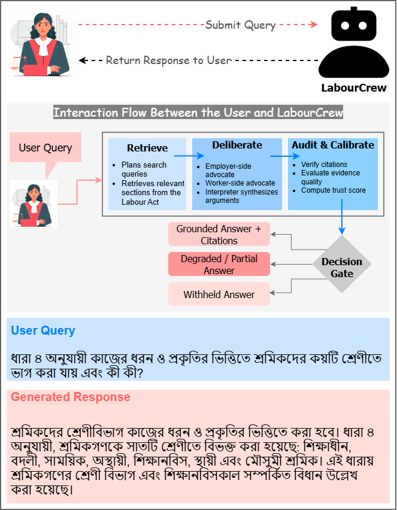
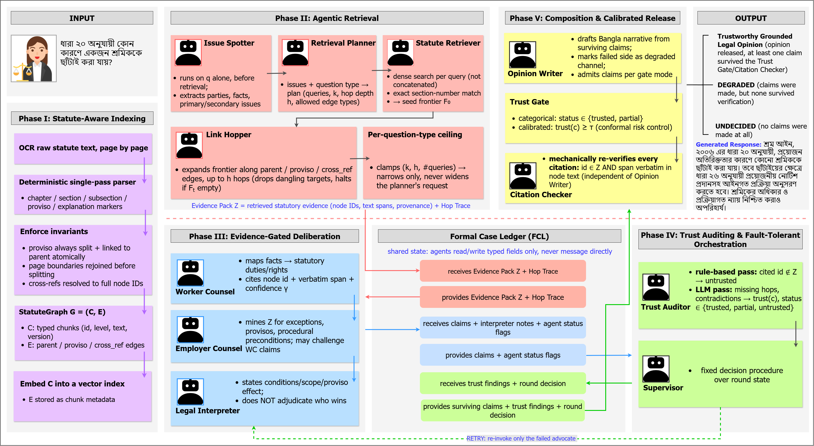
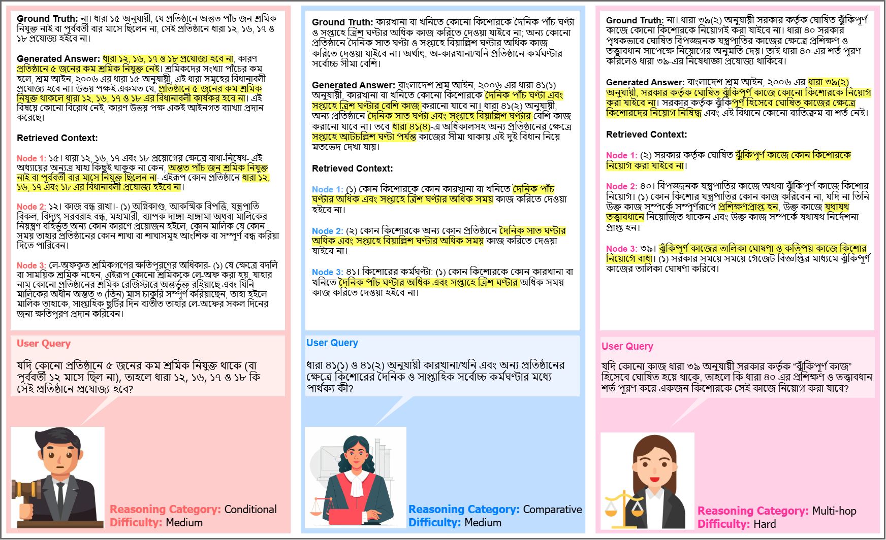

# LabourCrew: A Multi-Agent RAG Framework for Trustworthy Adversarial Deliberation and Statutory Reasoning over Labour Law

In statutory question answering, every claim must be traceable to evidence, not merely relevant, since unverifiable labour-rights answers carry serious legal consequences. Single-pass RAG cannot detect insufficient evidence, and multi-agent legal-debate systems treat grounding as a prompting convention, letting agents cite unretrieved evidence. **LabourCrew** argues that faithfulness must be an architectural constraint, not a prompting convention, and closes that gap with four core contributions built around an eleven-agent board:

| Contribution | What it does | Why it matters |
|---|---|---|
| **StatuteGraph** | A structure-preserving statutory index: a graph that explicitly links chapter, section, proviso, and cross-reference structure, instead of fixed-length spans | A proviso is never separated from the rule it qualifies |
| **Evidence Exchange Protocol (EEP)** | Confines advocates and the interpreter to a shared, retrieval-populated evidence ledger, so citing unretrieved text is structurally impossible, not just discouraged | Grounding is enforced by restriction, not instruction |
| **Fault-Tolerant Supervisor** | Runs the Worker Counsel and Employer Counsel advocates in parallel and isolates, rather than propagates, a failing role, retrying only the agent that failed | A single agent's error degrades the run instead of crashing the whole pipeline |
| **Calibrated Trust Gate** | Replaces categorical accept/reject with a numeric trust score, thresholded via Conformal Risk Control for a distribution-free bound on the false-accept rate | Release decisions carry a provable error guarantee, not an arbitrary cutoff |

A fifth contribution, the **LabourActQA** benchmark (below), is released alongside the framework so these claims can be independently evaluated on an under-served statutory domain.

We evaluate on **LabourActQA**, a 500-item Bangla question set built directly over the Bangladesh Labour Act, 2006, spanning seven reasoning categories and three difficulty tiers. LabourCrew drives the empirical false-accept rate to **0.081** (within the target α = 0.10), achieves the highest Answer Relevancy among HyDE RAG, Graph-RAG, and Hierarchical RAG (**0.862** vs. 0.839 / 0.815 / 0.828), and degrades gradually rather than catastrophically as question difficulty increases.

- 📄 Paper: https://arxiv.org/abs/2609.27814
- 🤗 Dataset: https://huggingface.co/datasets/Fatema142/LabourActQA



---

## Framework

A query flows through five phases, all agents communicating only through the shared **Formal Case Ledger (FCL)**:

| Phase | Agent(s) | Role |
|---|---|---|
| I. Statute-Aware Indexing *(offline)* | N/A | Structure-preserving parser builds **StatuteGraph**: chapter/section/proviso/cross-reference as typed edges, not fixed-length windows |
| II. Agentic Retrieval | Retrieval Planner, Statute Retriever, Link Hopper | Plan semantic queries and hop depth from the Issue Spotter's extracted issues; retrieve, then expand along statute links on demand |
| III. Evidence-Gated Deliberation | Issue Spotter, Worker Counsel, Employer Counsel, Legal Interpreter | Opposing claims argued only from the retrieved Evidence Pack, since advocates have no retrieval tool of their own |
| IV. Trust Auditing & Fault-Tolerant Orchestration | Trust Auditor, Supervisor | Score every claim's grounding; retry a failed advocate, request more retrieval, or proceed, isolating failure per-agent |
| V. Composition & Calibrated Release | Opinion Writer, Citation Checker | Draft the opinion, mechanically re-verify every citation, then gate release as **TGLO**, **DEGRADED**, or **UNDECIDED** via the calibrated Trust Gate |



The Trust Auditor scores each claim as a weighted composite of validity (cited IDs exist in evidence), fidelity (cited spans are verbatim), provenance (retrieval confidence), and the advocate's self-reported confidence. At release, the gate accepts a claim iff `trust(c) ≥ τ`, where `τ` is set offline by **Conformal Risk Control** to guarantee `E[false-accept rate(τ)] ≤ α` over future questions. If no threshold satisfies the bound, the gate fails closed and rejects every claim.

---

## Dataset: LabourActQA

500 Bangla question–answer pairs built directly over the Bangladesh Labour Act, 2006, hand-constructed in a three-stage protocol (collaborative drafting → independent dual-reviewer verification → consensus resolution), with inter-rater reliability of Krippendorff's α = 0.86. Each item carries a stable identifier, a reasoning-category and difficulty-tier label, and parallel Bangla/English question and reference-answer fields.

| Reasoning Type | Difficulty | N |
|---|---|--:|
| Direct Factual Retrieval | Easy | 78 |
| Definitional and Classification | Easy | 76 |
| Procedural Reasoning | Medium | 61 |
| Conditional Reasoning | Medium | 74 |
| Comparative Reasoning | Medium | 70 |
| Multi-hop Reasoning | Hard | 74 |
| Hypothetical Legal Reasoning | Hard | 67 |
| **Total** | | **500** |

---

## Results

**RAGAS evaluation against ablations and external retrieval baselines** (n = 500, GPT-4.1 judge):

| Configuration | Answer Relevancy ↑ | Context Relevancy ↑ | Context Precision ↑ | Context Recall ↑ | Noise Sensitivity ↓ |
|---|--:|--:|--:|--:|--:|
| **LabourCrew** | **0.862** | **0.891** | **0.914** | **0.913** | **0.081** |
| w/o Trust Auditor | 0.839 | 0.880 | 0.879 | 0.904 | 0.121 |
| w/o Link Hopper | 0.842 | 0.829 | 0.844 | 0.844 | 0.129 |
| w/o Worker Counsel | 0.833 | 0.885 | 0.891 | 0.905 | 0.095 |
| w/o Employer Counsel | 0.846 | 0.887 | 0.902 | 0.908 | 0.089 |
| w/o Legal Interpreter | 0.838 | 0.882 | 0.894 | 0.904 | 0.094 |
| w/o Citation Checker | 0.836 | 0.874 | 0.872 | 0.899 | 0.123 |
| Hierarchical RAG | 0.828 | 0.872 | 0.853 | 0.898 | 0.117 |
| HyDE RAG | 0.839 | 0.858 | 0.861 | 0.905 | 0.135 |
| Graph-RAG | 0.815 | 0.850 | 0.842 | 0.902 | 0.156 |

**Per-category execution-trace evaluation**, easiest → hardest (EC: Evidence Coverage, PC: Path Completeness, GVCP: Gate-Verified Citation Precision, CBP: Citation-Based Precision):

| Category | N | Lat. (s) | Rounds | EC | PC | GVCP | TGLO | CBP |
|---|--:|--:|--:|--:|--:|--:|--:|--:|
| Direct Factual Retrieval | 78 | 19.7 | 1.00 | 0.949 | 0.979 | 1.000 | 100.0% | 0.763 |
| Definitional and Classification | 76 | 20.5 | 1.00 | 0.912 | 0.965 | 1.000 | 100.0% | 0.679 |
| Procedural Reasoning | 61 | 24.5 | 1.01 | 0.894 | 0.972 | 0.998 | 100.0% | 0.630 |
| Conditional Reasoning | 74 | 22.3 | 1.02 | 0.905 | 0.988 | 0.985 | 99.0% | 0.641 |
| Comparative Reasoning | 70 | 23.0 | 1.01 | 0.930 | 0.964 | 1.000 | 100.0% | 0.680 |
| Multi-hop Reasoning | 74 | 30.2 | 1.14 | 0.804 | 0.958 | 0.975 | 97.0% | 0.412 |
| Hypothetical Legal Reasoning | 67 | 30.8 | 1.18 | 0.829 | 0.903 | 0.979 | 97.0% | 0.521 |

Gate-verified citation precision and the decisive-opinion (TGLO) rate stay nearly flat across difficulty; only citation-based precision drops on the hardest categories, since the system works harder (more rounds, higher latency) rather than relaxing what it is willing to cite.

**Calibrated vs. categorical release gate** (target risk α = 0.10):

| Gate Mode | GVCP | Empirical False-Accept Rate | Guarantee Holds? | TGLO Rate |
|---|--:|--:|:--:|--:|
| Categorical (LLM-decided) | 0.938 | 0.147 | **No** | 97.6% |
| **Calibrated (CRC, ours)** | **0.991** | **0.081** | **Yes** | **99.0%** |

**Human evaluation** (two legal-domain evaluators, 1–5 Likert scale):

| Criterion | Mean ± SD |
|---|--:|
| Correctness | 4.61 ± 0.54 |
| Faithfulness | 4.74 ± 0.46 |
| Completeness | 4.52 ± 0.61 |
| Clarity | 4.67 ± 0.49 |
| Citation Quality | 4.79 ± 0.42 |
| Overall Quality | 4.68 ± 0.45 |



**Headline ablation findings:**
- Structure-aware retrieval beats dense-only search monotonically as layers are added (dense 0.52 → +BM25 0.69 → +link hops 0.74 → full StatuteGraph **0.78** initial retrieval precision).
- The Evidence Exchange Protocol cuts unsupported claims from 6.4% to **1.2%** while every other metric improves alongside it: the restriction closes a real gap, not a conservatism trade-off.
- Fault-tolerant orchestration cuts failed runs by an order of magnitude: 14.2% (sequential, no supervision) → **1.0%** (full supervisor), while latency falls over the same progression.
- The full Trust Gate drives citation error from 0.441 (no gate) to **0.009**, combining the Citation Checker and Trust Auditor rather than either catching the same errors alone.

---

## Why Gemini for OCR, not the PDF's text layer or GPT-4o(-mini)

The source PDF is typeset in a legacy pre-Unicode Bangla font (SutonnyMJ/ShonarBangla). These fonts store glyphs in visual draw order and hijack ASCII code points for common conjuncts (শ্র, প্র, ...), so direct text extraction (pypdf, PyMuPDF `get_text()`) silently corrupts the statutory text. GPT-4o-mini and GPT-4o vision were both tested on rendered page images and **hallucinated**: invented wording, wrong section numbers, one inserted a random English word mid-sentence. `gemini-3-flash-preview` vision transcription was cross-checked against the source images and reproduced the text (including exact section/subsection numbers) correctly, so it is the OCR path used here. Still: **spot-check OCR output against the source PDF** before treating it as gold data.

## Setup

Preferred (via [`uv`](https://docs.astral.sh/uv/), reads `pyproject.toml`/`uv.lock`):

```bash
uv sync
cp .env.example .env   # then fill in OPENAI_API_KEY and GEMINI_API_KEY
```

Alternative (plain `pip`):

```bash
pip install -r requirements.txt
cp .env.example .env   # then fill in OPENAI_API_KEY and GEMINI_API_KEY
```

Neither path installs this repo as a package: `[tool.uv] package = false` in `pyproject.toml` keeps `uv sync` from trying to build/install a `labourcrew` wheel. `labourcrew`/`statutegraph` are importable because `scripts/*.py` inserts the repo root onto `sys.path` at the top of the file. Always run scripts from the repo root (`python scripts/ask.py ...`, or `uv run python scripts/ask.py ...` if you used `uv sync`).

Requires Python 3.11+. Tested on Python 3.13/3.14, Windows, with Milvus Lite (embedded, no server).

## Running the pipeline

```bash
# 1. OCR the raw PDF (caches per-page text under data/processed/<name>/pages/)
python scripts/ingest_pdf.py data/raw/Bangladesh-Labour-Act-2006-Amended-Chapter2.pdf

# 2. Chunk + embed + upsert into Milvus
python scripts/ingest_chunks.py data/processed/Bangladesh-Labour-Act-2006-Amended-Chapter2.txt --recreate-collection

# 3. Ask a question
python scripts/ask.py "একজন শ্রমিক হিসেবে চাকুরীর শর্ত সংক্রান্ত বিধি সম্পর্কে প্রতিষ্ঠান কী ব্যতিক্রম করতে পারে?"
```

(Prefix each `python ...` above with `uv run` if you set up the environment via `uv sync`.)

`scripts/ask.py` prints the final status (`TGLO` / `DEGRADED` / `UNDECIDED`), the opinion narrative, accepted/rejected/undecided claim IDs, the trustworthiness scorecard, and every agent's status (so a failed/degraded agent is always visible, never silent).

### Evaluation and calibration

```bash
python scripts/evaluate_system.py        # deterministic, execution-trace metrics (Table: per-category / aggregate)
python scripts/evaluate_ragas.py         # RAGAS metrics against baselines
python scripts/calibrate_trust_gate.py   # fit the Conformal-Risk-Control threshold tau
python scripts/ablate_trust_gate.py      # categorical vs. calibrated gate comparison
```

Retrieval-strategy baselines (HyDE, Hierarchical, Graph-RAG) live under `ablation_study/`, each as its own self-contained pipeline sharing `ablation_study/common.py` / `board_common.py`.

## Citation

```bibtex
@misc{faria2026labourcrewmultiagentrag,
  title         = {LabourCrew: A Multi-Agent RAG Framework for Trustworthy Adversarial
                   Deliberation and Statutory Reasoning over Labour Law},
  author        = {Fatema Tuj Johora Faria and others},
  year          = {2026},
  eprint        = {2609.27814},
  archivePrefix = {arXiv},
  primaryClass  = {cs.CL},
  url           = {https://arxiv.org/abs/2609.27814}
}
```

## License

See [`LICENSE`](LICENSE).
